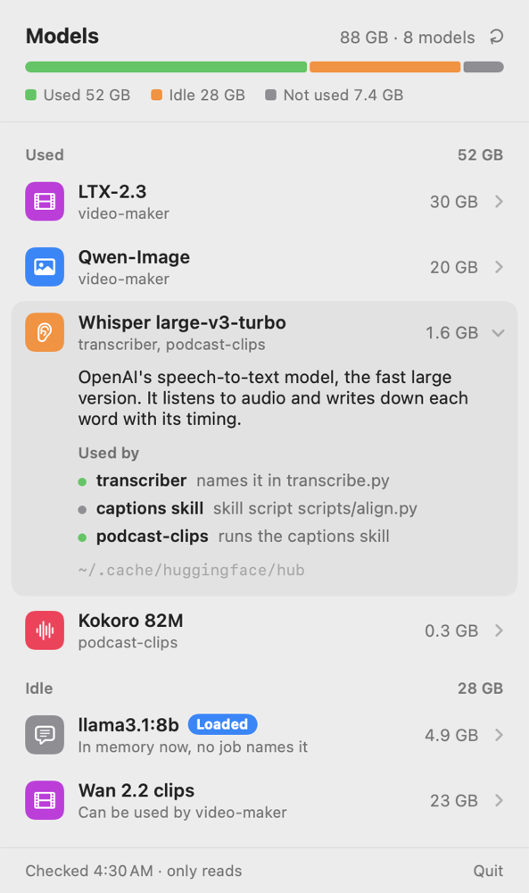

# Model Shelf

A small macOS menu bar app that shows every AI model on your Mac: how much space each one takes, what it does, and
which of your scheduled jobs and Claude Code skills actually use it. It keeps itself current, and it only reads.



*The screenshot uses made-up demo data (`docs/demo-scan.json`).*

## Why

Local models pile up. A few months of trying image, video, voice and text models leaves a hundred or more gigabytes
in caches, and nobody remembers which ones still matter. Model Shelf answers three questions at a glance:

- **What do I have?** Hugging Face caches, ComfyUI-style model folders, LM Studio, and Ollama, with real sizes
  (files shared between models are counted once).
- **What uses it?** It reads the code of every launchd job in `~/Library/LaunchAgents` and every skill in
  `~/.claude/skills`, and lists each job or skill that names a model. It follows one step further: a job that runs a
  script or a skill which names the model counts too.
- **What can go?** Models nothing uses are grouped under "Not used". Ollama models in memory right now are marked
  "Loaded".

It stays live: it checks again every 15 minutes, and when you open it if the last check is more than 5 minutes old.
A new model shows up on its own, marked "New". A new job that uses a model shows up under it. A removed model drops off.

## Safety and privacy

- **Read only.** It never moves, changes or deletes a file, and it never stops or starts a job.
- **No network**, except asking a local Ollama (`127.0.0.1`) what it holds. No telemetry, no accounts, no updates.
- **Skips private and data folders.** It does not read `~/Desktop`, `~/Documents`, `~/Downloads`, `~/Library`,
  `~/Pictures`, `~/Movies` or `~/Music`, or folders named `data`, `state`, `logs`, `runs`, `out`, `cache` and the
  like. In a git repository it reads only tracked files. It reads only code files (scripts, settings), never JSON
  outside settings files, and only looks for model names; it stores nothing but the matching file paths.
- **No admin rights.** It installs into your home folder and runs as you.

## Install

Needs macOS 14 or newer and Xcode or the Command Line Tools (`xcode-select --install`).

```bash
git clone https://github.com/maxketamine-spec/model-shelf.git
cd model-shelf
./scripts/install.sh
```

The stack icon appears in the menu bar. It starts at login and comes back if it crashes; **Quit** keeps it closed until
the next login. To remove it: `./scripts/uninstall.sh`.

## Settings

Optional. Without a settings file it looks in `~/.cache/huggingface/hub`, `~/ComfyUI/models`, `~/.lmstudio/models`,
Ollama at `127.0.0.1:11434`, and skills in `~/.claude/skills`. To change that, or to describe your models, create
`~/Library/Application Support/Model Shelf/shelf.json`. Every field is optional; see
[`docs/shelf.example.json`](docs/shelf.example.json).

| Field | What it does |
|---|---|
| `hfStores` | Hugging Face cache folders (the `hub` folder). |
| `fileStores` | Folders of loose model files, such as ComfyUI's `models`. Files of 5 MB or more count. |
| `ollama` | Ollama's address, or `null` to skip it. |
| `skills` | Folders of Claude Code skills. |
| `agents` | Friendly names for job folders, e.g. `{"~/agents/video": "Video maker"}`. |
| `skillNames` | Friendly names for skills. |
| `skipAgents` | Job folders to leave out. |
| `ignoreFiles` | Paths inside a job folder that do not count (tests and docs by default). |
| `models` | Descriptions. Each has `id`, `name`, `kind`, `what`, and `match`: globs on the file's path from your home folder, or `ollama/<tag>`. Optional `icon` (an SF Symbol), `color`, `note`, `status` (`idle` or `unused`, for a model the code names but never calls) and `notUsedBy` (names to drop when the code search links one by mistake). |

Grouping matters for models that load helper files: put a model's text encoder, VAE or add-ons in its `match` list,
and any model that another library loads for it (one video model loads a separate text model, for example).

## Limits

- It finds uses by name in code. A model loaded only by a third-party library, or chosen at run time from a setting
  it cannot read, will look unused until you group or describe it in the settings.
- Apart from Ollama's "Loaded", it does not watch what runs. "Used" means a job or skill names the model.
- Only launchd jobs and skills count as users. Scripts you run by hand do not.

## Command line

```bash
"Model Shelf.app/Contents/MacOS/ModelShelf" --scan                                  # one scan as JSON
"Model Shelf.app/Contents/MacOS/ModelShelf" --snapshot out.png [model-id] [scan.json]   # the panel as a picture
```

## Development

```bash
swift build
swift test            # scanner tests against a fake home folder
./scripts/build-app.sh
```

`Sources/ShelfCore` is the scan (no UI); `Sources/ModelShelf` is the menu bar app.

## License

MIT. See [LICENSE](LICENSE).
